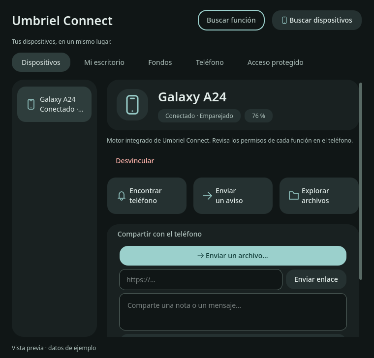

# Umbriel Connect

Tu teléfono integrado con **Umbriel, Noctalia y undershell**, con cliente C++20/Qt6
y aplicación Android propia. **0.4.2 experimental** incorpora un motor privado derivado
de KDE Connect: ya no necesita ejecutar sus aplicaciones de escritorio o móvil.
Sí utiliza Qt/KDE Frameworks y conserva el protocolo y los créditos del código original.



[Descargar Android completo 0.4.2](downloads/UmbrielConnect-0.4.2.apk) ·
[Instalación y compilación](docs/BUILDING.md) ·
[Funciones y límites comprobados](docs/COMPATIBILITY.md) ·
[Seguridad y permisos](SECURITY.md)

## Qué integra

- Descubrimiento, emparejamiento, batería, señal móvil, archivos, enlaces y texto.
- Notificaciones con acciones/respuesta, portapapeles, multimedia/MPRIS y volumen.
- Mensajes SMS/MMS y contactos, avisos de llamada y encontrar dispositivos.
- Entrada remota, presentación, tableta y órdenes, con permisos y opt-in por dispositivo.
- Explorador de archivos y ventana de mensajes incluidos en el prefijo privado.
- Pantalla interactiva, cámara frontal/posterior, webcam bajo demanda y audio Bluetooth,
  desde la sección **Teléfono**, mediante scrcpy/ADB, v4l2loopback y BlueZ.
- Controles propios de escritorios, foco, sonido, tema y no molestar; editor, widgets,
  rendimiento, mascotas y perfiles de undershell.
- Galería móvil/escritorio de undershell-wall con miniaturas, favoritos y filtros por
  carpeta/origen: imágenes propias o Wallpaper Engine.
- Canal TLS propio con certificado fijado, acceso automático en LAN, autorización remota y archivos grandes en
  ambos sentidos. Integración Yazi `umbriel-connect --send ARCHIVOS...`.

El motor deriva de las fuentes oficiales C++ y Android, mantenidas como submódulos
fijados. Los extras de pantalla/cámara se portaron desde las funciones de
[Caelestia Connect](https://github.com/maylton/caelestia-connect) y su
[fork de KingSahil](https://github.com/KingSahil/caelestia-connect).
[Procedencia y licencias](THIRD_PARTY_NOTICES.md).

**Límites actuales:** el monitor virtual requiere un backend de credenciales seguro
y un portal compatible y permanece bloqueado. Las funciones Wayland, cámara, SMS,
Bluetooth y permisos Samsung requieren validación física; compilar los plugins no
prueba que todos funcionen en el compositor. [Matriz detallada](docs/COMPATIBILITY.md).

## Instalar y enlazar

```bash
git submodule update --init --recursive
./install.sh
~/.local/bin/umbriel-connect
```

Consulta primero las [bibliotecas necesarias](docs/BUILDING.md). El instalador
respalda los binarios anteriores, compila y prueba los dos proyectos, e instala en
`~/.local`. `./install.sh --autostart` habilita sus servicios de usuario al iniciar
la siguiente sesión gráfica; la opción predeterminada conserva los procesos actuales.
No modifica red, firewall, atajos ni configuraciones de otros programas. No elimina
el paquete KDE Connect existente; utiliza su propio servicio y plugins privados.

Instala el APK completo y abre **Funciones del teléfono**. En LAN puedes emparejar
el motor nuevo comparando la clave en ambos extremos. Las claves privadas de KDE
Connect no se importan. La actualización conserva paquete, firma y registros propios
anteriores. No necesitas borrar los datos ni volver a registrar normalmente.

**En LAN directa, los dispositivos vinculados se conectan automáticamente**, también
con la app en segundo plano y notificación visible. **Fuera de ella, Android exige
huella o el PIN, patrón o contraseña del teléfono** por hasta diez minutos. Al bloquear
termina la autorización remota; el control del teléfono siempre respeta su bloqueo.
«Pausar conexión» desactiva la reconexión hasta presionar Conectar. Los permisos
Android y los plugins siguen siendo decisiones independientes.

Un registro antiguo puede pedir **una última huella para migrar las claves**: su
clave original solo aceptaba biometría. Después permite también el bloqueo del teléfono.
Si esa huella ya no está disponible, se necesita un registro nuevo; no se omite la
validación de identidad. Los permisos remotos persistentes de 0.4.0 se retiran.
[Corrección del cierre reportado y estados de conexión](docs/UPDATE-0.4.2.md).

El APK ampliado incluye capacidades sensibles opcionales. Si Play Protect impide
instalarlo, no desactives esa protección; conserva la edición mínima
[Umbriel Remote 0.3.1](downloads/UmbrielRemote-0.3.1.apk), solo teléfono→PC, y comunica
el diagnóstico sin compartir datos personales. [Contexto de distribución](docs/PLAY-PROTECT.md).

## Navegar con teclado

**Ctrl+K** busca y localiza una función sin ejecutarla; **Alt+1…5** cambia de sección.
Tab/Mayús+Tab recorre controles, IJKL y flechas navegan, Enter/Espacio activan y F1
muestra ayuda. Los campos conservan sus letras normales; Esc/Q cierran fuera de
edición. El diseño sigue la paleta Noctalia con variantes clara/oscura y foco visible,
sin animaciones permanentes. [Diseño](docs/DESIGN.md).

## LAN, Tailscale y archivos

En la misma red no necesitas Tailscale. El canal propio descubre la computadora en
LAN y mantiene la misma verificación TLS. Fuera de casa puedes usar el proxy privado
Tailscale Serve ya configurado para controles y archivos. El modo **userspace** no
transporta automáticamente todos los plugins, SFTP, ADB ni multicast del motor.
Bluetooth y webcam son locales. [Restricciones completas](docs/COMPATIBILITY.md).

Los archivos del motor usan streaming binario TLS; el selector informa cuando se
ponen en cola, sin confundirlo con recepción confirmada. El canal firmado propio
conserva SHA256, espacio disponible, progreso y recepción confirmada; su codificación
Base64 añade aproximadamente un tercio al tráfico. [Archivos grandes](docs/LARGE-FILES.md).

La ventana de envío comparte tema y estados con el programa. Si Yazi todavía abre
un selector antiguo, vuelve a abrir Yazi para cargar su configuración actualizada.

## CLI y desarrollo

```bash
umbriel-connect list
umbriel-connect commands
umbriel-connect watch
umbriel-connect --send /ruta/archivo
umbriel-connect-features
umbriel-connect-messages
umbriel-connect-protocol --help
```

Los controles también pueden publicarse en el plugin de órdenes del **motor propio**;
`umbriel-connect publish ID` respalda y conserva órdenes personales, y `withdraw ID`
retira solo las generadas por Umbriel. La ruta firmada no necesita activar ese plugin.
El widget Noctalia sigue siendo opcional y no se activa automáticamente.

[Compilación y pruebas aisladas](docs/BUILDING.md). El Python original se conserva
como referencia histórica, fuera de la ruta instalada. No se han capturado pantallas,
mensajes, archivos ni cámaras reales de usuarios durante las pruebas de esta versión.
