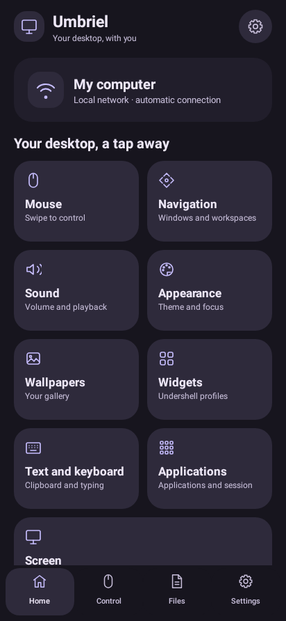
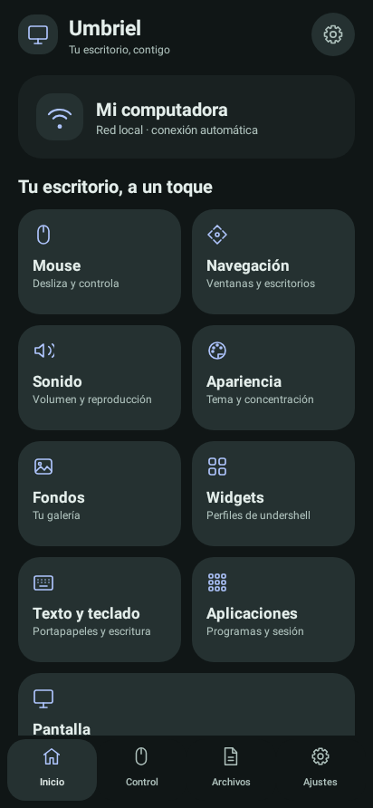
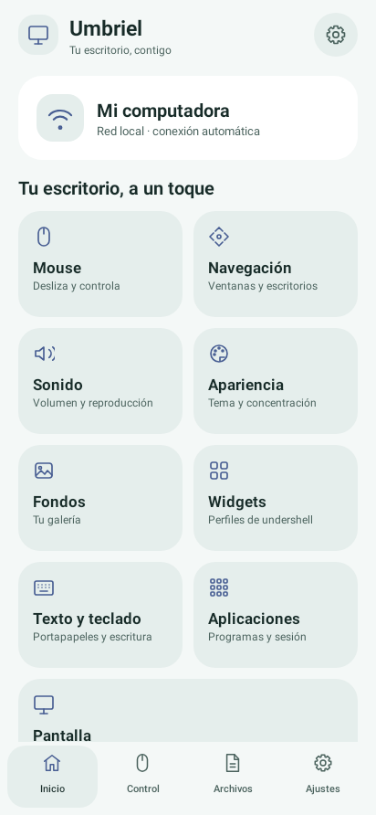

# Umbriel Connect

Your phone integrated with **Umbriel, Noctalia and undershell**, with a C++20/Qt6
client and its own Android app. The **experimental desktop and Android 0.8.0 releases**
include a private engine derived from KDE Connect, so you no longer need to run its
desktop or mobile applications. Qt/KDE Frameworks are still required, and the original
protocol and code credits are preserved.



[Download the full Android app 0.8.0](downloads/UmbrielConnect-0.8.0.apk) ·
[Installation and building](docs/BUILDING.md) ·
[Verified features and limitations](docs/COMPATIBILITY.md) ·
[Security and permissions](SECURITY.md)

Android opens on **Home**, with one-tap access to Mouse, Navigation, Sound, Appearance,
Wallpapers and Widgets, plus playback and volume controls. It also offers Text and
keyboard, Applications and Screen. You can send multiple files and choose the app's
language, palette and theme. The **Home / Control / Files / Settings** bar stays visible;
pairing and permissions have their own section. Paired devices connect automatically
on the LAN; connections outside it require explicit authorization.
[What's new in 0.8: screen, text, applications, files and colors](docs/UPDATE-0.8.0.md).




## Features

- Discovery, pairing, battery status, mobile signal, files, links and text.
- Notifications with actions and replies, clipboard, multimedia/MPRIS and volume.
- Mobile media player with actual playback state, artwork, title/source and player
  selection; PC audio output selection and touchpad direction preferences.
- SMS/MMS messages and contacts, call notifications and device finding.
- Remote input, presentations, tablet input and commands, with permissions and
  per-device opt-in.
- File browser and messaging window included in the private installation prefix.
- Interactive screen mirroring, front/rear cameras, an on-demand webcam and Bluetooth
  audio from the **Phone** section, using scrcpy/ADB, v4l2loopback and BlueZ.
- Dedicated controls for workspaces, window focus, sound, themes and Do Not Disturb;
  undershell editing, widgets, performance, pets and profiles.
- Mobile/desktop undershell-wall gallery with thumbnails, favorites and folder/source
  filters for your own images or Wallpaper Engine content.
- A dedicated TLS channel with certificate pinning, automatic LAN access, remote
  authorization and large files in both directions. Yazi integration through
  `umbriel-connect --send FILES...`.

The engine derives from the official C++ and Android sources, maintained as pinned
submodules. The additional screen/camera features were ported from
[Caelestia Connect](https://github.com/maylton/caelestia-connect) and
[KingSahil's fork](https://github.com/KingSahil/caelestia-connect).
[Provenance and licenses](THIRD_PARTY_NOTICES.md).

**Current limitations:** the virtual monitor requires a secure credentials backend
and a compatible portal, and remains disabled. Wayland, camera, SMS, Bluetooth and
Samsung permissions require testing on real devices; compiling the plugins does
not prove that all of them work in the compositor.
[Detailed compatibility matrix](docs/COMPATIBILITY.md).

## Release packages

The [experimental v0.8.0 release](https://github.com/EternalSelf-2328/KDE-connect-Umbriel-undershell/releases/tag/v0.8.0)
provides the signed Android APK, complete sources and native Linux packages for
Arch, Debian 13, Ubuntu 26.04 LTS, Fedora 44, Void (glibc) and NixOS 26.05 on x86_64.
See [package installation and rebuilding](packaging/README.md) for the matching format,
optional services and the differences from a user-prefix source installation.

## Install and pair

```bash
git submodule update --init --recursive
./install.sh
~/.local/bin/umbriel-connect
```

Check the [required libraries](docs/BUILDING.md) first. The installer backs up previous
binaries, builds and tests both projects, and installs into `~/.local`.
`./install.sh --autostart` enables its user services for the next graphical login;
the default option preserves running processes. It does not modify networking,
firewall rules, shortcuts or other applications' settings. It does not remove an
existing KDE Connect package; it uses its own service and private plugins.

Install the full APK and open **Home** on both devices on the same LAN. In Android,
select the discovered computer and request pairing. Compare the code on both screens
and confirm on the PC. This is a one-time setup and does not require a file. Private
QR/JSON pairing remains available under **Settings → Pair with QR code…**.
Clearing Android app data requires pairing again; updating the APK preserves it.

For compatible engine plugins, **Settings → Devices and features** lets you pair by
comparing the key on both devices. Their trust remains separate from the signed
control channel; identities are not merged by name or IP address. KDE Connect private
keys are not imported. Updates preserve the package, signing identity and existing
Umbriel pairing records. You normally do not need to clear data or register again.

**On a direct LAN, paired devices connect automatically**, including when the app
is in the background, with a visible notification. **Outside the LAN, Android requires
a fingerprint or the phone's PIN, pattern or password** for up to ten minutes. Locking
the phone ends remote authorization; phone control always respects its lock state.
“Pause connection” disables reconnection until you press Connect. Android permissions
and plugin activation remain separate choices.

An older pairing may request **one final fingerprint to migrate its keys**: the
original key only accepted biometrics. After migration, the phone's screen lock is
also supported. If that fingerprint is no longer available, a new pairing is
required; identity verification is not bypassed. Persistent remote permissions from
0.4.0 are removed.
[Reported crash fix and connection states](docs/UPDATE-0.4.2.md).

The full APK includes optional sensitive capabilities. If Play Protect blocks its
installation, do not disable that protection; keep the minimal
[Umbriel Remote 0.3.1](downloads/UmbrielRemote-0.3.1.apk), which only controls the PC
from the phone, and share the diagnostic without personal data.
[Distribution details](docs/PLAY-PROTECT.md).

## Keyboard navigation

**Ctrl+K** finds a feature without running it; **Alt+1…5** switches sections in the
sidebar. Tab/Shift+Tab moves between controls, IJKL and arrow keys navigate,
Enter/Space activates controls, and F1 shows help. Text fields keep their normal
letter input; Esc/Q closes the window outside text editing. The design follows
Noctalia's palette, with light/dark variants and visible keyboard focus, without
continuous animations. [Design](docs/DESIGN.md).

## LAN, Tailscale and files

You do not need Tailscale on the same network. If the computer does not appear, check
[the dedicated firewall ports](docs/FIREWALL.md): allowing KDE Connect alone does not
cover UDP31595/TCP31594. The dedicated channel discovers the computer on the LAN
and keeps the same TLS verification. Outside your home network, you can use a private
Tailscale Serve proxy configured for controls and files. **Userspace** mode does not
automatically carry all engine plugins, SFTP, ADB or multicast traffic. Bluetooth and
webcam features are local. [Full limitations](docs/COMPATIBILITY.md).

Engine file transfers use binary TLS streaming; the picker reports when files are
queued, without presenting that as confirmed delivery. The dedicated signed channel
retains SHA256 verification, free-space checks, progress and confirmed receipt;
Base64 encoding adds approximately one third to the traffic.
[Large files](docs/LARGE-FILES.md).

The sharing window uses the same theme and states as the main application. If Yazi
still opens an older picker, reopen Yazi to load its updated configuration.

## CLI and development

```bash
umbriel-connect list
umbriel-connect commands
umbriel-connect watch
umbriel-connect --send /path/to/file
umbriel-connect-features
umbriel-connect-messages
umbriel-connect-protocol --help
```

Controls can also be published to the **private engine's** command plugin;
`umbriel-connect publish ID` backs up and preserves personal commands, while
`withdraw ID` removes only those generated by Umbriel. The signed channel does not
require that plugin to be enabled. The Noctalia widget remains optional and is not
activated automatically.

[Building and isolated tests](docs/BUILDING.md). The original Python code is preserved
as a historical reference, outside the installed execution path. No users' real
screens, messages, files or cameras were captured during this release's tests.
