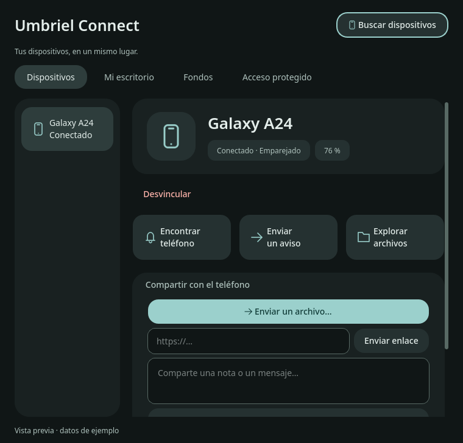
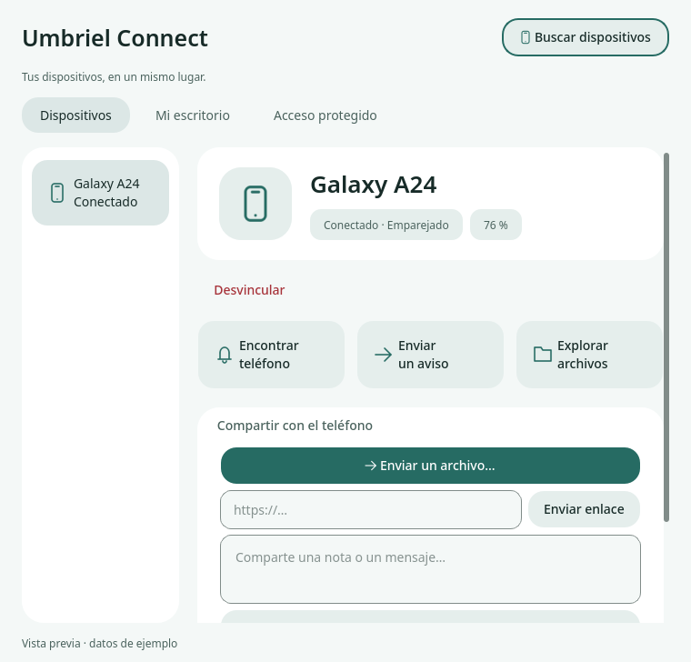
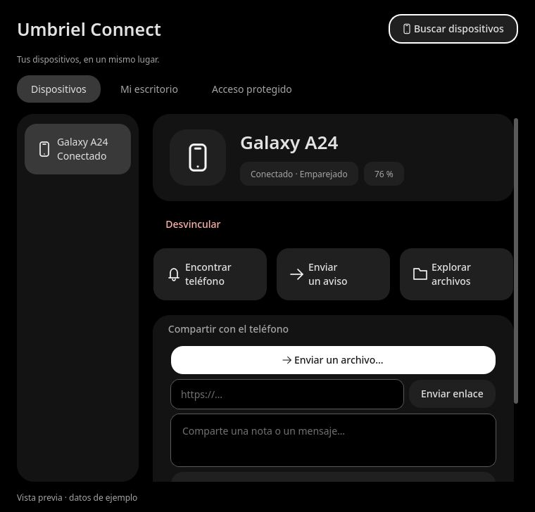
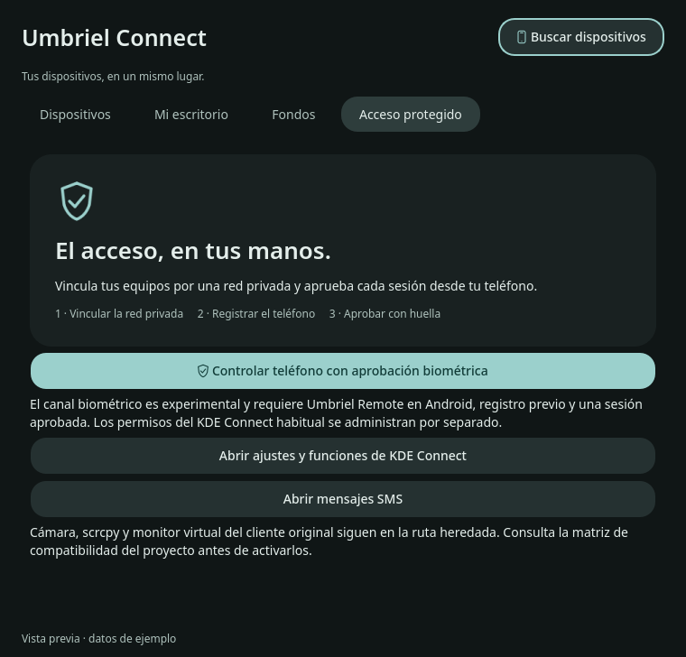

# Diseño nativo y móvil

La interfaz conserva las tarjetas, el estado del dispositivo y las acciones directas
del cliente original. Comparte superficies redondeadas y una jerarquía de color
con Noctalia y undershell. La acción principal de la vista de dispositivos es
compartir; la del móvil es conectar con aprobación biométrica.

## Escritorio

- Paleta central en `native/design.cpp`: fondo, superficie, elevación tonal, texto,
  texto secundario, acento, texto sobre acento, contorno y error.
- Por defecto lee los roles de `~/.config/gtk-4.0/noctalia.css`. Detecta cambios y
  reemplazos atómicos del archivo sin sondeo continuo. Actualiza también los iconos.
- Alternativas propias claras y oscuras si no hay paleta exportada. Para elegir:
  `UMBRIEL_CONNECT_THEME=light`, `dark` o `system` antes del ejecutable.
- Tarjeta de dispositivo, chips de conexión/batería, acciones breves y sección de
  compartir. Configuración de controles separada del acceso biométrico.
- Pestañas Dispositivos, Mi escritorio y Acceso protegido. Desplazamiento vertical
  para mantener accesibles los controles en ventanas compactas.
- Tipografía instalada Google Sans Flex, Inter o Noto Sans, sin descargar fuentes.
  Iconos lineales dibujados con Qt, sin imágenes de terceros.
- Foco visible, estados hover/presionado/deshabilitado y navegación IJKL/flechas.
  Las letras IJKL y Q se escriben normalmente dentro de campos de texto.
- Sin desenfoque, sombras grandes ni animaciones continuas. No se midió una mejora
  porcentual de GPU ni se afirma que el proceso consuma cero en cualquier condición.

| Oscuro | Claro |
|---|---|
|  |  |





Las capturas son renders Qt offscreen con datos sintéticos. No son una conexión
real al Galaxy ni incluyen contenido del escritorio del usuario. El tamaño inicial
se deriva de la geometría lógica disponible, con un mínimo funcional de 760×480;
los controles del teléfono usan sus dimensiones actuales, sin resolución fija.

## Android

La descarga 0.1.1 muestra una tarjeta «Control de computadora» y no ofrece control
del celular. El selector de accesibilidad descrito abajo corresponde únicamente a
la variante opcional `phone-control`, pendiente de revisión.

`UiDesign.java` centraliza colores, tipografía, tarjetas, botones y estados. Usa la
configuración clara/oscura y el acento dinámico de Android cuando está disponible.
Los tamaños emplean dp/sp e insets del sistema, con desplazamiento vertical.

La pantalla presenta la computadora, el registro en tres pasos, el permiso opcional
de control del teléfono y el botón Conectar con huella. El JSON se importa desde un
archivo privado o un diálogo avanzado; no ocupa la pantalla principal. Tras conectar,
los controles se agrupan en widgets, escritorios/ventanas y sonido/apariencia.
Cambiar la computadora o los permisos cierra la sesión anterior y exige aprobación
para la siguiente.

**Límite de comprobación:** la UI Android está compilada y firmada, pero todavía no
se renderizó en emulador ni se probó en el Galaxy A24. Faltan inspección visual real,
rotación, fuentes grandes, lector de pantalla y estados OEM del diálogo biométrico.
No se publica un mockup como evidencia de una pantalla Android ejecutada.

## Comprobaciones

- Test de diseño con contrastes de texto normales de al menos 4,5:1 en ambas paletas.
- Pares medidos con el script de contraste: texto sobre tarjeta 13,84:1 oscuro y
  14,87:1 claro; texto secundario 8,80:1 y 6,57:1; botón principal 7,22:1 y 6,24:1.
- Ventanas 780×600, 900×640 y 1100×720, todas las pestañas sin desplazamiento horizontal.
- Entrada de texto sin interceptar IJKL/Q, navegación real en lista y cambio atómico
  de paleta. Capturas aisladas revisadas en claro, oscuro y con la paleta Noctalia.

```bash
ctest --test-dir build --output-on-failure
UMBRIEL_CONNECT_THEME=dark QT_QPA_PLATFORM=offscreen build/umbriel-connect --preview build/design.png
UMBRIEL_CONNECT_THEME=light QT_QPA_PLATFORM=offscreen build/umbriel-connect --preview build/design-light.png
```
